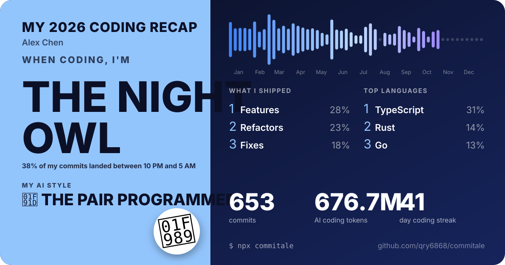
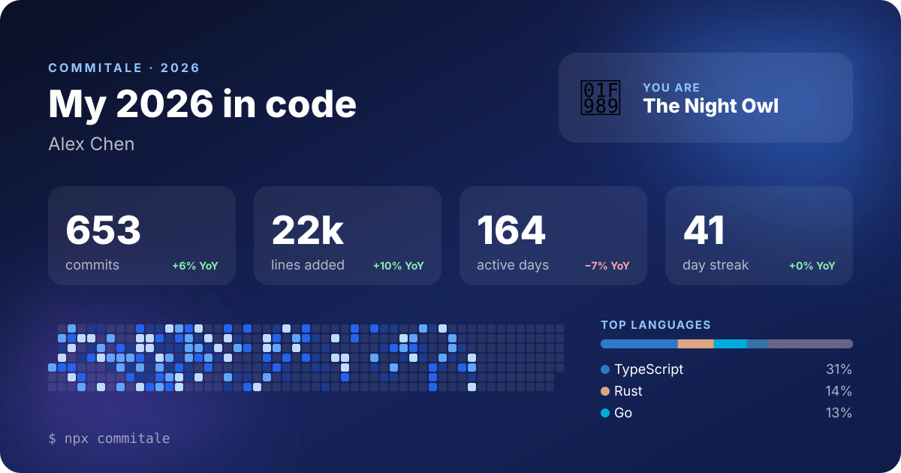

<div align="center">

# Commitale

**Your year in code, told as a story.** A Spotify Wrapped-style report for your git history.

One command. Every repo on your machine. Nothing leaves your computer.

[](https://www.npmjs.com/package/commitale)
[](https://github.com/qry6868/commitale/actions/workflows/ci.yml)

[](LICENSE)

English · [简体中文](docs/README.zh-CN.md)

<a href="https://qry6868.github.io/commitale/"></a>

**[▶ See a live demo](https://qry6868.github.io/commitale/)**: a full report on sample data, nothing to install.

</div>

## Quick start

**You need:** [Node.js](https://nodejs.org) 20 or newer, and git. Check by running `node -v` and `git --version`. If either says "not found", install it first.

1. **Open a terminal.** On macOS, open Terminal. On Windows, open PowerShell or Windows Terminal.
2. **Run it.** If npx asks `Ok to proceed? (y)`, press `y`.

   ```bash
   npx commitale
   ```

   Commitale finds your repositories on its own. Inside a project, it wraps that project. Otherwise it looks under the current folder, then searches your home folder (and your other drives on Windows), and lists what it found.

   Want specific folders only? Name them: `npx commitale ~/code` or `npx commitale D:\projects`.
3. **Read your year.** The report opens in your browser. Scroll through it; the last page has buttons to download your share card.

The report (`commitale-2026.html`) and card (`commitale-2026.svg`) are saved in the folder you ran the command from, so you can open them again later. Something went wrong? See [Troubleshooting](#troubleshooting).

## What you get

- **The big numbers.** Commits, lines added and deleted, active days, repos touched, and how they compare with last year.
- **Your year as a heatmap.** Every day, across every repo: your private work too, not just what GitHub sees.
- **Streaks and spikes.** Your longest run of consecutive days and your busiest day.
- **Your rhythm.** The hour you peak, your power weekday, your biggest month.
- **Moments.** Your first commit of the year, your latest-night commit (yes, that 3:47 AM one) and your biggest.
- **Languages and repos.** Where your time actually went.
- **Your words.** The words you reach for most in commit messages, and how many commits were fixes.
- **Your AI year.** The tokens you spent with Claude Code and Codex, how many sessions and days, your top models, your biggest AI day, and your [AI style](#ai-styles).
- **Your coding personality.** Night Owl, Weekend Warrior, Marathoner, Bug Hunter… see [all of them](#personalities).
- **A soundtrack.** A mellow lo-fi loop, synthesised live in your browser (no audio files), starts on your first tap. The button in the corner turns it off.
- **Share cards in two styles and three sizes.** A bold poster or a stats card; wide for X, LinkedIn and your GitHub profile, square and vertical for Instagram, WeChat Moments and Xiaohongshu. Each personality has its own colors. Download as PNG or SVG.

It runs in your terminal too:

```
  ✦ commitale 2026  ·  Alex Chen

  653 commits  ·  across 5 repos, on 164 different days  +6% vs the same time last year
  +21,851  −12,760
  ◆ AI usage  674M tokens  🤝 The Pair Programmer  across 498 sessions, on 277 days · Claude Code 97%, Codex 3%

  ·▓·░░···▒░░█▓▒█··▒·▒··░█·▒····▒·▒░░··▓░█············
  ▓▒██·▓··██▒░▒▓░█·█░··█▒·▓▒░·█·▒····█▓···▓···········
  ░█·░▓·▒░██░░░▓▓░█·▓▒·█▓·█··░·····░▒▓▒░··▓░··········
  █·░▒█▓▓▓▒░█▓░▓▒▓░█···▒·▒·▒░·██··▓··░█░·▓░·█·········
  ▓▒▒···░▓░▓░▓░▒░·▒·····░▒░··░░·█··░·▓···▒░·▒▓·········
  ··█▒····▒░░▒▓█░█··▓░░·▓·░·····▒···░░···▒···░········
  ···▓·█·▓·█▒▓▒█····░·▒█······░··········▒···█········

  Longest streak        41 days Mar 1 → Apr 10
  Busiest day           Mar 2 · 36 commits
  Peak hour             10 PM
  Latest-night commit   04:47 "docs: auth flow"

  Top languages
  TypeScript  ███████░░░░░░░░░░░░░░░░░  31%
  Rust        ███░░░░░░░░░░░░░░░░░░░░░  14%
  Go          ███░░░░░░░░░░░░░░░░░░░░░  13%

  You are 🦉 The Night Owl
```

## Private by design

Commitale reads your local repositories with `git log` and writes two files next to you: an HTML report and an SVG card. It makes **no network requests**: no telemetry, no API tokens, no uploads. The report works offline.

For the AI page, it reads the logs Claude Code (`~/.claude/projects`) and Codex (`~/.codex/sessions`) keep on your machine, and takes **only usage counts, timestamps and model names** from them: never your prompts, replies or code. Don't want it? Add `--no-ai`.

The share cards never show repo names or commit messages; only the report you keep does. Showing the report itself to someone, say about work? `--anonymize` hides them there too.

## More ways to run it

```bash
npx commitale                       # finds your repos automatically
npx commitale ~/code ~/work         # several folders
npx commitale ~/code --year 2025    # another year
npx commitale . --all-authors --name "Team Rocket"   # a team report
```

| Option | Description |
| --- | --- |
| `-y, --year <year>` | Year to wrap. Defaults to this year (last year during January). |
| `-a, --author <id>` | Your email or name. Repeat it for several identities. Defaults to `user.email` and `user.name` from your global and per-repo git config. |
| `--all-authors` | Count everyone's commits, for a team report. |
| `--name <name>` | Name shown on the report. |
| `-d, --depth <n>` | How many folder levels to search for repositories (default `3`). |
| `-o, --out <dir>` | Where to write the report and card (default: current folder). |
| `--lang <en\|zh>` | Report language. Defaults to your system locale. |
| `--anonymize` | Hide repo names and commit messages. |
| `--json` | Print the raw stats as JSON and write no files. |
| `--no-open` | Don't open the report in a browser. |
| `--no-ai` | Skip the AI usage page. |

### Commit from more than one email?

Commitale picks up the emails configured in each repo automatically. For anything else (an old laptop, a GitHub noreply address) add them:

```bash
npx commitale ~/code -a me@work.com -a me@home.dev -a 1234+me@users.noreply.github.com
```

If nothing matches, Commitale lists the authors it found so you can pick yours.

### Put the card on your GitHub profile



Commit the generated `commitale-2026.svg` to your profile repository (`<username>/<username>`) and add:

```markdown

```

## Troubleshooting

| What you see | What to do |
| --- | --- |
| `npx` is not recognized, or `command not found` | Install [Node.js](https://nodejs.org) 20 or newer, then open a new terminal window. |
| PowerShell says `npx.ps1 cannot be loaded because running scripts is disabled` | Run `npx.cmd commitale` instead. Or allow local scripts once with `Set-ExecutionPolicy -Scope CurrentUser RemoteSigned`. |
| `No git repositories found …` | Name the folder that holds your projects, e.g. `npx commitale D:\projects`. If they sit more than 3 folders deep, add `--depth 5`. |
| Fewer repos than expected | Raise `--depth`. Hidden folders, `node_modules`, `vendor` and build folders are skipped on purpose. |
| `No commits by … in 2026` | Your commits use a different email. Commitale prints the authors it found; pass yours with `-a you@example.com`. |
| The browser doesn't open | Open `commitale-2026.html` from the folder where you ran the command. |

## Personalities

You get the first one that fits, plus badges for the rest.

| | Personality | You earn it when… |
| --- | --- | --- |
| 🦉 | The Night Owl | 30%+ of your commits land between 10 PM and 5 AM |
| 🌅 | The Early Bird | 25%+ of your commits land between 5 and 9 AM |
| ⚔️ | The Weekend Warrior | 35%+ of your commits happen on weekends |
| 🏃 | The Marathoner | you commit 21+ days in a row |
| 🐛 | The Bug Hunter | 30%+ of your commits are fixes |
| 🧹 | The Cleaner | you delete more code than you add (and at least 1,000 lines) |
| 🌍 | The Polyglot | 5+ languages each make up 5%+ of your changes |
| 💼 | The Professional | 70%+ of your commits are on weekdays, 9 to 6 |
| 🧱 | The Steady Builder | none of the above: you just keep shipping |

## AI styles

Nearly everyone codes with AI now, so the question is how much. Your AI style comes from the total tokens you spent this year. Anthropic puts the average Claude Code user at about [$13 per active day](https://code.claude.com/docs/en/costs), which works out to a few billion tokens a year, so the middle tier sits there.

| | Style | Tokens this year |
| --- | --- | --- |
| 🔍 | The Spot Checker | under 500M |
| 🤝 | The Pair Programmer | 500M to 2B |
| 🧭 | The Navigator | 2B to 10B |
| 🎩 | The Delegator | 10B to 40B |
| 🌊 | The Vibe Coder | 40B and up |

## How it counts

- **Commits** are non-merge commits on any branch, authored in the given year, matched to you by email or name. A commit that appears in several clones or forks is counted once.
- **Times** use the timezone you committed in, so a 2 AM commit while traveling is still a 2 AM commit.
- **Lines** skip lock files, build output, vendored code, minified files and source maps.
- **Languages** are detected by file extension, with GitHub Linguist colors.
- **AI tokens** add up input, output and cache reads and writes, the way the tools bill them. A reply that Claude Code logs more than once is counted once.

## Contributing

Ideas, bug reports and pull requests are very welcome. New personalities and translations are a great first contribution.

```bash
git clone https://github.com/qry6868/commitale && cd commitale
npm install
npm run demo     # builds fake repos with a year of history and runs on them
npm test
```

Translations live in [`src/i18n.ts`](src/i18n.ts). Add a language there and to `--lang`.

## License

[MIT](LICENSE)

<div align="center">

If commitale made you smile, **[give it a ⭐](https://github.com/qry6868/commitale)** so more developers find it.

</div>
