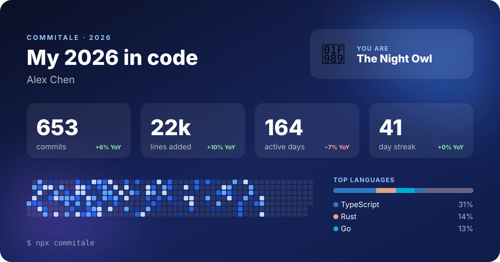

<div align="center">

# Commitale

**把你这一年的提交，讲成一个故事。** 像 Spotify Wrapped 一样回顾你这一年的 git 提交。

一条命令，扫描你电脑上的所有仓库，数据完全不离开本机。

[](https://www.npmjs.com/package/commitale)
[](https://github.com/qry6868/commitale/actions/workflows/ci.yml)

[](LICENSE)

[English](README.md) · 简体中文



</div>

```bash
npx commitale ~/code
```

就这么简单。Commitale 会找到目录下的所有 git 仓库，读取你今年的提交，然后在浏览器里打开一份可以滑动浏览的年度报告。

## 你会看到什么

- **核心数据**：提交次数、新增和删除的代码行数、活跃天数、参与的仓库数。
- **全年热力图**：覆盖所有仓库的每一天，包括公司内网和私有仓库，不只是 GitHub 上能看到的。
- **连续提交和高峰**：最长连续提交天数，以及最忙的一天。
- **你的节奏**：一天中最活跃的时段、一周中的高产日、最忙的月份。
- **难忘时刻**：年度第一次提交、最晚的一次提交（没错，就是凌晨 3:47 那次），以及最大的一次提交。
- **语言和仓库**：你的时间到底花在了哪里。
- **提交信息词云**：你最常用的词，以及有多少次提交是在修 bug。
- **编程人格**：夜猫子、周末战士、马拉松选手、捉虫猎人……见[全部人格](#编程人格)。
- **分享卡片**：1200×630 的卡片，可以直接发朋友圈、微博、X 或放进 GitHub 个人主页（支持下载 PNG 和 SVG）。

终端里也能直接看：

```
  ✦ commitale 2026  ·  Alex Chen

  653 次提交  ·  分布在 5 个仓库，共 164 天
  +21,851  −12,760

  最长连续提交     41 天 3月1日 → 4月10日
  最忙的一天       3月2日 · 36 次提交
  最活跃时段       22:00
  最晚的一次提交   04:47 "docs: auth flow"

  你是 🦉 夜猫子
```

## 隐私优先

Commitale 只通过 `git log` 读取本地仓库，然后在当前目录生成两个文件：一份 HTML 报告和一张 SVG 卡片。它**不发送任何网络请求**：没有统计上报，不需要 API Token，不上传任何东西。报告离线也能打开。

要分享和工作相关的内容？加上 `--anonymize` 即可隐藏仓库名和提交信息。

## 用法

```bash
npx commitale                       # 当前所在的仓库或目录
npx commitale ~/code ~/work         # 多个目录
npx commitale ~/code --year 2025    # 其他年份
npx commitale . --all-authors --name "火箭队"   # 团队报告
```

| 选项 | 说明 |
| --- | --- |
| `-y, --year <年份>` | 统计的年份。默认今年（1 月份时默认去年）。 |
| `-a, --author <身份>` | 你的邮箱或名字，可重复使用来指定多个身份。默认取全局和各仓库 git 配置里的 `user.email` 和 `user.name`。 |
| `--all-authors` | 统计所有人的提交，生成团队报告。 |
| `--name <名字>` | 报告上显示的名字。 |
| `-d, --depth <n>` | 向下搜索仓库的目录层数（默认 `3`）。 |
| `-o, --out <目录>` | 报告和卡片的输出目录（默认当前目录）。 |
| `--lang <en\|zh>` | 报告语言，默认跟随系统语言。 |
| `--anonymize` | 隐藏仓库名和提交信息。 |
| `--json` | 以 JSON 输出原始统计数据，不写文件。 |
| `--no-open` | 不自动在浏览器中打开报告。 |

需要 Node.js 20+ 和 git。

### 用了多个邮箱提交？

Commitale 会自动读取每个仓库里配置的邮箱。其他邮箱（比如旧电脑、GitHub noreply 地址）可以手动添加：

```bash
npx commitale ~/code -a me@work.com -a me@home.dev -a 1234+me@users.noreply.github.com
```

如果一个提交都没匹配上，Commitale 会列出它找到的所有作者，方便你选出自己。

### 把卡片放到 GitHub 个人主页

把生成的 `commitale-2026.svg` 提交到你的个人主页仓库（`<用户名>/<用户名>`），然后在 README 中加入：

```markdown

```

## 编程人格

你会得到第一个符合条件的人格，其余符合的会作为徽章显示。

| | 人格 | 获得条件 |
| --- | --- | --- |
| 🦉 | 夜猫子 | 30% 以上的提交在晚上 10 点到凌晨 5 点之间 |
| 🌅 | 早起鸟 | 25% 以上的提交在早上 5 点到 9 点之间 |
| ⚔️ | 周末战士 | 35% 以上的提交在周末 |
| 🏃 | 马拉松选手 | 连续 21 天以上每天都有提交 |
| 🐛 | 捉虫猎人 | 30% 以上的提交是修 bug |
| 🧹 | 代码清洁工 | 删除的代码比新增的多（且至少 1000 行） |
| 🌍 | 多语言玩家 | 5 种以上语言各占你改动的 5% 以上 |
| 💼 | 准点打工人 | 70% 以上的提交在工作日 9 点到 18 点之间 |
| 🧱 | 稳健建造者 | 以上都不是：你只是一直在稳定输出 |

## 统计规则

- **提交**：任意分支上的非合并提交，作者时间在指定年份内，按邮箱或名字匹配到你。同一个提交出现在多个克隆或 fork 中只计一次。
- **时间**：使用提交时所在的时区，出差时凌晨 2 点的提交依然算凌晨 2 点。
- **代码行数**：排除 lock 文件、构建产物、vendor 代码、压缩文件和 source map。
- **语言**：按文件扩展名识别，颜色与 GitHub Linguist 一致。

## 参与贡献

非常欢迎提想法、报 bug 和提 PR。新增编程人格或新语言翻译都是很好的第一次贡献。

```bash
git clone https://github.com/qry6868/commitale && cd commitale
npm install
npm run demo     # 生成带有一年历史的模拟仓库并运行
npm test
```

翻译文本都在 [`src/i18n.ts`](src/i18n.ts) 中。

## 许可证

[MIT](LICENSE)

<div align="center">

如果 commitale 让你会心一笑，**[点个 ⭐](https://github.com/qry6868/commitale)** 让更多开发者看到它。

</div>
